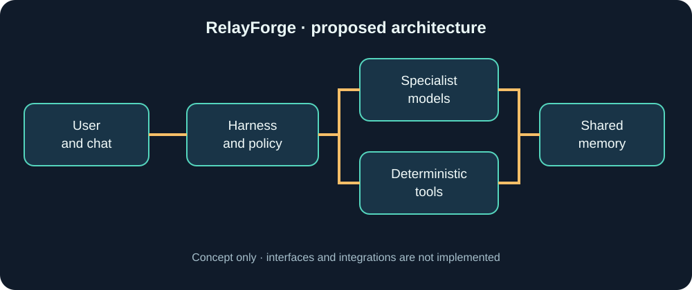

# RelayForge

**A modular harness for separating conversation from task execution.**

RelayForge is an early-stage design for an assistant architecture in which a conversational model translates user requests and presents results, while a separate harness routes work to specialized models and deterministic tools. Workers can be activated only when needed, with a shared store preserving task state and evidence across sessions.

> **Status: concept / design.** This repository does not yet implement an orchestration engine, models, tool execution, or the integrations described below.

## Why

A single conversational model does not need to perform every step of every task. Separating interaction, routing, execution and memory may make it possible to run some workflows on smaller machines and delegate demanding work to suitable resources. Any savings in memory, latency, energy or tokens must be measured; they are not established by this design.

## Proposed architecture

- **Chat gateway:** interpret requests, ask for missing information, and communicate outcomes.
- **Harness:** route tasks, manage resources and model lifecycles, and coordinate execution.
- **Workers:** execute deterministic operations or call specialized coding, reasoning, and vision models as needed.
- **Shared memory:** retain task state, decisions, evidence and references independently of model lifetimes.
- **Policy and evaluation:** bound permissions, select resources, and compare outcomes with their costs.

Structured messages can make interfaces easier to validate and audit. Binary encoding alone does not reduce LLM token usage; the system must also limit the context sent to models.

## First experiment

Compare a single tool-using conversational model with a split configuration using a small chat model, a router, and an on-demand coding model. Use the same real coding tasks, test suites, permissions and stopping rules. Record task success, peak RAM and VRAM, loading time, end-to-end latency, input/output tokens and energy where measurable. Report failures and hardware configuration alongside results.

## Design directions

1. Define versioned task and result contracts with explicit status, provenance and errors.
2. Implement a deterministic router and a minimal worker before adding model integrations.
3. Add model lifecycle management and resource accounting, then benchmark sequential loading.
4. Explore adapters for Parcimonia and Inception; these are proposals, not existing integrations.
5. Compare against a single-model baseline before claiming efficiency gains.

See [the architecture notes](docs/architecture.md) and [an illustrative task](examples/task.json).

## License

[Apache License 2.0](LICENSE).
